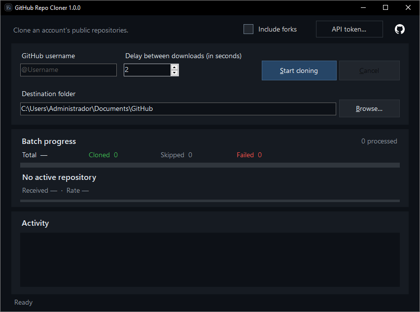
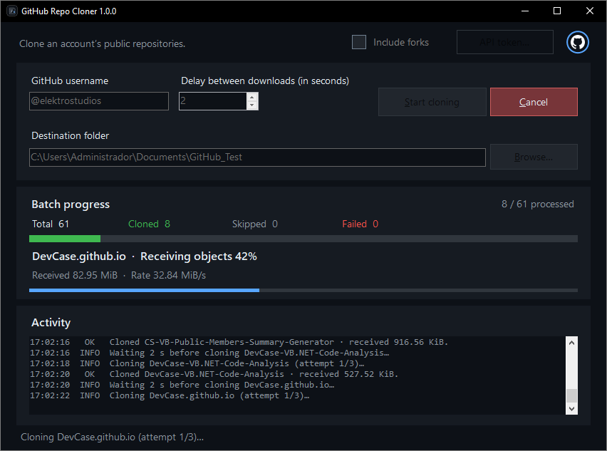

<!-- Common Project Tags:
desktop-app 
desktop-application 
dotnet 
netframework 
netframework48 
tool 
tools 
vbnet 
visualstudio 
windows 
windows-app 
windows-application 
windows-applications 
windows-forms 
winforms 
windowsapp 
desktopapp 
desktopapplication 
windowsapplication 
 -->

  

  <h1>GitHub Repo Cloner</h1>

### Clone an account’s public GitHub repositories in one go.

------------------

    &nbsp;
    &nbsp;
    &nbsp;
    
    &nbsp;
    
   
   
    
    
    
    
    
    
   
    
    
    
    
    
    
   
   
    

------------------

## 👋 Introduction

GitHub Repo Cloner is a Windows desktop app that clones the public repositories owned by a GitHub user or organization. Enter the account name, choose where to store the repositories, and follow the batch from a single window.

## 💡 Motivation

Keeping a local copy of your GitHub projects can mean tracking down dozens of clone URLs and running the same command over and over. This tool automates discovery and cloning, so you can repeat the operation when new projects appear.

## 🖼️ Screenshots

  
    
  

## 🤖 Features

- Clone public repositories owned by the account in a single batch, with an **Include forks** option (off by default).
- Choose the destination folder and an optional delay between downloads.
- Track total, processed, and failed repositories, along with the current Git phase and transfer statistics.
- Skip existing destinations so you can repeat a batch without replacing local copies.
- Monitor every operation in real time with a built-in activity log.

## ⚠️ Limitations

- The app works with public repositories.
- Repositories are cloned one at a time. GitHub API limits can interrupt discovery and the activity log reports when you can retry.
- Received size and speed are shown when Git reports them. The final transfer size may be unavailable beforehand.

Optional advanced setup for GitHub request limits

You can clone public repositories without signing in to GitHub or setting up a token.

If GitHub limits how often you can list repositories, open **API token…**, paste a GitHub personal access token, and choose **Save**. Windows encrypts the saved token for your Windows user account. Open the same dialog to replace or remove it. Removing the local copy leaves the token itself active on GitHub.

If you previously configured the Windows environment variable `GITHUB_TOKEN`, the app uses it only when there is no token saved in the app.

## 📝 Requirements

- Windows with [.NET Framework 4.8](https://dotnet.microsoft.com/en-us/download/dotnet-framework/net48) or a compatible later version.
- [Git for Windows](https://git-scm.com/install/windows).
- An internet connection with access to GitHub.

## 🚀 Getting Started

1. Download the ZIP from [Releases](https://github.com/ElektroStudios/GitHub-Repo-Cloner/releases) and extract it.
2. Open `Windows/GitHub Repo Cloner.exe`. Keep all supplied DLLs and the configuration file alongside the executable.
3. Enter the account name, choose the destination, and set the delay. Use `0` seconds to remove the pause.
4. Select **Start cloning**. Select **Cancel** to stop an active batch.

### Build and test

Open `GitHub Repo Cloner.slnx` in Visual Studio with the .NET desktop development workload and the .NET Framework 4.8 targeting pack. Restore NuGet packages, build, and run the xUnit v3 tests from Test Explorer.

## 🔄 Change Log

See the [release notes](https://github.com/ElektroStudios/GitHub-Repo-Cloner/releases).

------------------

## 🏆 Credits

- [Windows Forms and .NET Framework](https://dotnet.microsoft.com/en-us/download/dotnet-framework)
- [Git for Windows](https://git-scm.com/install/windows)
- [GitHub REST API](https://docs.github.com/en/rest)
- [Ookii.Dialogs.WinForms](https://github.com/ookii-dialogs/ookii-dialogs-winforms) provides the native Windows folder picker.
- [xUnit.net v3](https://xunit.net/)

## 💪 Contributing

Please [open an issue](https://github.com/ElektroStudios/GitHub-Repo-Cloner/issues/new/choose) to report a bug or suggest an improvement.

## 💰 Beyond Contribution

This work is distributed for educational purposes and without any profit motive. However, if you find value in my efforts and wish to support and motivate my ongoing work, you may consider contributing financially through the following options:

| Platform | How to Support |
| :---: | :--- |
|  | **[Become my sponsor on GitHub](https://github.com/sponsors/ElektroStudios/)** Contribute any amount you prefer and unlock rewards! |
|  | **[Support me on Ko-fi](https://ko-fi.com/elektrostudios)** Buy me a coffee! |
|  | **[Become a Patron on Patreon](https://www.patreon.com/c/elektrostudios/membership)** Support my open-source work regularly! |
|  | **[Make a PayPal Donation](https://www.paypal.com/cgi-bin/webscr?cmd=_s-xclick&hosted_button_id=E4RQEV6YF5NZY)** Donate any amount you like via PayPal! |
|  | **[Purchase my software at Envato's CodeCanyon](https://codecanyon.net/item/elektrokit-class-library-for-net/19260282)** Discover my desktop tools and **DevCase Class Library for .NET**, an extensive API suite. |

 

  <b>Your support means the world to me! Thank you for considering it! 🤗💗</b>

------------------

## ⚠️ Disclaimer

This software and its associated repository are provided strictly on an "as is" basis, without warranties of any kind, whether express or implied. This includes, but is not limited to, any implied warranties of merchantability, reliability, or fitness for a particular purpose.

The authors and copyright holders assume no liability for any direct, indirect, incidental, or consequential damages—including data loss or system errors—arising from the use, misuse, or inability to use this software. You are solely responsible for determining the appropriateness of using this tool and assume all associated risks.

Furthermore, this project operates entirely independently. The utilization of any third-party libraries or components within this software does not imply any affiliation with, or endorsement or approval by, their respective original authors.

This software may interact with third-party services, websites, or platforms. It is the user's sole responsibility to ensure that such use complies with the applicable terms of service, laws, and regulations. The authors do not endorse, and are not responsible for, any misuse of this software to violate third-party terms of service or applicable law.

By using this software, you agree to indemnify and hold harmless the authors from any claims, damages, or liabilities arising from your use or misuse of it.
